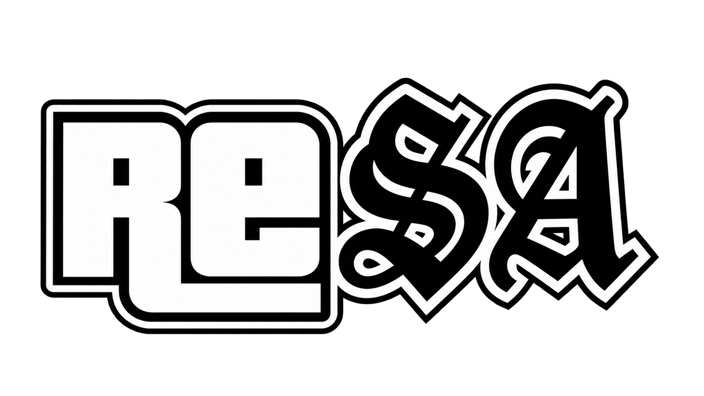

<p align="center">
  
</p>

# GTA San Andreas · Reversing en ReSA

Recrear GTA San Andreas PC de forma funcionalmente equivalente mediante código fuente reconstruido en C++, reduciendo hasta eliminar la dependencia de funciones originales del ejecutable. La meta final es una reconstrucción completa y validada, seguida de un ejecutable propio: **ReSA — Zero Original Function Dependency** ([hoja de ruta](docs/ProjectRoadmap.md)).

**[📊 Progreso detallado](docs/ReversedClasses.md) · [🗺️ Mapa de clases y funciones](docs/MemoryMap/index.html) · [🧭 Qué abordar después](docs/ReversingPriorities.md) · [🧪 Pruebas](reversing/README.md) · [📋 Proceso y continuidad](reversing/MEJORAS_DEL_PROCESO.md) · [🕘 Historial](docs/archivo/Historial.md)**

> [!NOTE]
> Este README describe el trabajo local de la rama **ReSA**. El avance registrado y los bancos aprobados no equivalen a cobertura exhaustiva ni a estabilidad general del juego.

## Estado actual

<!-- RESA-PROGRESO:BEGIN -->
Tres conceptos distintos, que no se mezclan en ninguna cifra:

- **Reconstruida:** la función existe en C++ puro, tiene su hook en la DLL y compila. Es lo que mide el EXE (`hooks.csv`, `reversed=1`).
- **Validada:** además se comparó con el EXE dentro del juego (≥16.384 pares sin diferencias, oráculo independiente y prueba negativa de dos rondas) y su evidencia está en el registro (`validated=1`).
- **Reconstruida sin validar:** integrada y activa, pero sin banco todavía (`validated=0`). Compila, pero no se ha ejecutado en el juego contra el original.

Y dos zonas del EXE que se miden por separado: el **código del juego** (0x401000–0x74FFFF, el trabajo propio del proyecto) y **RenderWare y D3D** (0x750000–0x81FFFF, el SDK enlazado dentro del EXE).

Cifras al 17/11/2026.

| Zona | Funciones a reconstruir | Reconstruidas | Entradas del catálogo | Validadas | Sin validar |
| --- | ---: | ---: | ---: | ---: | ---: |
| **Código del juego** | 11.686 | 11.686 (100,00%) | 11.613 | 11.230 | 383 |
| **RenderWare y D3D** | 724 | 724 (100,00%) | 822 | 77 | 745 |

**Cómo leer la tabla:** «Funciones a reconstruir» y «Reconstruidas» se cuentan en funciones del EXE; «Validadas» y «Sin validar» se cuentan en entradas del catálogo (`hooks.csv`), y suman las «Entradas del catálogo». No coinciden con las funciones porque una función puede tener varias entradas (cuerpo, destructor con borrado, ranura virtual, envoltura). En el código del juego se descartan 118 funciones excluidas (no reconstruibles en C++ puro); en RenderWare, 1.111 funciones de libpng, zlib y D3DX9 (se enlaza la original) y 54 no reconstruibles.

En total hay **12.441 entradas reconstruidas, 11.313 validadas y 1.128 sin validar** en el catálogo (11.313 con evidencia registrada). Quedan además 6 entradas fuera de ambas zonas (CRT y utilidades).

### Fase del proceso

| Fase | Estado |
| --- | --- |
| Reconstruir el código del juego en C++ puro | **Hecha**: 100,00% de las funciones y 100,00% de los bytes; faltan 0 y hay 118 excluidas por no ser reconstruibles |
| Reconstruir el SDK de RenderWare | **Hecha**: 724 de 724 funciones reconstruibles (100,00%); aparte, 1.111 son libpng, zlib y D3DX9 (se enlaza la original) y 54 no son reconstruibles |
| **Validar el código del juego** | **En curso**: 11.230 de 11.613 reconstruidas (96,70%); el resto va por oleadas de lotes (detalle en el [informe](docs/ReversedClasses.md#por-validar)) |
| Validar RenderWare | **Apenas empezada**: 77 de 822 (9,37%); falta el plan de bancos (dispositivo D3D falso, flujos y listas libres falsos) |
| Pase final de bancos viejos | Pendiente: repetir los bancos antiguos cuyos colaboradores ahora tienen hook o cuyo código cambió |
| Ejecutable propio | Después: sustituir RenderWare, D3D y CRT por bibliotecas y quitar la dependencia del EXE ([hoja de ruta](docs/ProjectRoadmap.md)) |
<!-- RESA-PROGRESO:END -->

### Lo que sigue y los límites

- **Ahora:** validar el código del juego por oleadas de lotes (cada lote con su banco `FnNNNA`; ver la [sección 4 del informe](docs/ReversedClasses.md#por-validar)). Después, el plan de bancos de RenderWare.
- **Las bibliotecas enlazadas no se reconstruyen:** libpng, zlib y D3DX9 se enlazarán con su versión original en el ejecutable propio; los puentes de QuickTime y las rutinas con registros no expresables en C++ puro están documentados como [no reconstruibles](docs/RenderWareExe/no-reconstruibles.csv) y [excluidas](docs/JuegoExe/excluidas.csv).
- **Reconstruida no es validada:** lo reconstruido sin validar está integrado y activo, pero no se ha comparado con el EXE dentro del juego. En RenderWare, nada se ha ejecutado todavía contra el original.
- **Todavía no es un ejecutable independiente:** el proyecto sigue dependiendo de `gta_sa.exe` y de los recursos del juego ([ruta hacia el EXE independiente](docs/RutaExeIndependiente.md)).
- **Límites de la validación:** la evidencia vale para los fixtures de cada banco y para el árbol en que se probó; la vigencia contra el árbol actual no está acreditada y no se afirma estabilidad general ([desviaciones conocidas](docs/DesviacionesConocidas.md)).
- **Todo en C++ puro:** `source/game_sa` no tiene `__asm` ni funciones `naked`. Regla del proyecto: todo lo que se reconstruya va en C++, dos archivos por clase (`.cpp` y `.h`) y sin duplicados ([proceso](reversing/CppOnlyMigration/PROCESO.md)).
- **Cómo se valida una función:** el mismo EXE con el hook apagado contra la DLL con el hook encendido, mínimo 16.384 pares y 0 diferencias, un oráculo Python independiente del código bajo prueba y una prueba negativa con mutaciones (dos rondas, y todas las funciones deben fallar con la mutación). Cuando una función pasa a tener hook, se repiten los bancos antiguos que la usan como colaborador.

## Cómo funciona

La compilación produce `gta_reversed.asi`, una DLL que carga un ASI loader. Los hooks redirigen funciones del ejecutable a sus reconstrucciones en C++; las direcciones como `0x571920` identifican entradas del original. El proyecto todavía depende del ejecutable y de los recursos del juego: no es un ejecutable independiente terminado.

El objetivo es preservar el comportamiento original. Cada reconstrucción se contrasta con el original antes de actualizar sus indicadores; una compilación correcta o un hook visible en el debug no sustituyen esa comparación.

[FLOSS: instalación local y análisis de cadenas](docs/FLOSS.md). Disponible para Codex y Claude en `C:\Users\pedro\Tools\FLOSS\floss.exe`; todavía no hay resultados de FLOSS registrados para ReSA.


## Instalación

### Abrir el juego desde el inicio

La copia de pruebas tiene `FastLoader.Enable = false` y `SaveGameToLoad = -2`. Muestra las pantallas de inicio y el menú; el usuario elige **Nueva partida** o **Cargar partida**.

```powershell
Set-Location 'E:\JUEGOS\GTA San Andreas - CVehicle Test'
& '.\gta_sa.exe' '--historical-hooks=E:\JUEGOS\GTA San Andreas - CVehicle Test\historical-hooks.txt'
```

Este arranque aplica el perfil histórico: sólo clases/grupos con todas sus entradas catalogadas marcadas validated=1. Sin el argumento de selección se conserva el comportamiento normal de la compilación. Los bancos automáticos activan temporalmente la carga rápida solicitando la ranura 2 y restauran los dos INI originales al terminar, incluso si la prueba falla.

[Configuración y comprobación del inicio](reversing/InicioNormal/README.md) · [Diagnóstico y reparación del cierre de audio](reversing/CAESound/README.md).

### Ejecutar las pruebas

Desde la raíz, usar el **único `PROBAR.cmd`**:

```powershell
.\PROBAR.cmd --list
.\PROBAR.cmd --case furniture
.\PROBAR.cmd --case playerinfo-constructor
.\PROBAR.cmd --all
```

Para ejecución sin la pausa final del CMD:

```powershell
python reversing/run.py --case furniture
python reversing/run.py --all
```

El catálogo está en [reversing/cases.json](reversing/cases.json). Las sondas deben estar compiladas y archivadas con el hash esperado por cada ejecutor; ejecutar un caso no recompila automáticamente la sonda. `--all` requiere disponer de los artefactos locales de todos los bancos.

El runner compartido comprueba el ejecutable, evita ejecuciones simultáneas, respalda ASI/PDB, instala la sonda, abre su propio GTA, audita los logs, cierra ese proceso y restaura los binarios y ambos INI. Verifica los hashes de las partidas. Los informes por caso quedan en la copia de pruebas; los informes conjuntos, en `reversing/artifacts/suite-*/summary.json`.

> [!IMPORTANT]
> `--all` ejecuta **sondas archivadas** de cada trabajo. No demuestra que todos los cambios sean estables juntos en la última compilación. La campaña de integración, guardado/carga y sesiones prolongadas se hará cuando estén completas todas las clases, según lo acordado en el [proceso](reversing/MEJORAS_DEL_PROCESO.md).

#### Instalación y datos protegidos

| Uso | Ruta del entorno local |
| --- | --- |
| Repositorio | `D:\Original\gta-reversed-master` |
| Copia de pruebas | `E:\JUEGOS\GTA San Andreas - CVehicle Test` |
| Instalación personal, conservar | `E:\JUEGOS\GTA San Andreas` |

La instalación normal se actualiza únicamente en la copia de pruebas y conserva un respaldo. Los cambios no deben sobrescribir partidas personales. El runner actual tiene rutas locales configuradas; revisar [runtime_runner.py](reversing/runtime_runner.py) y el proceso antes de usarlo en otra máquina. `PROBAR.cmd` también apunta al Python instalado en este equipo.

El ejecutable de referencia es **GTA SA Compact**, distinto de otros ejecutables llamados «1.0 US». SHA-256 verificado en este entorno:

```text
72ae59e44c761389e354a50dc6215e964fe771121e2f4b1877273a493ceecc9b
```

Los bancos habituales arrancan con `--unhook=Audio,Global/SurfaceInfos_c`. El caso `sound-copy` mantiene Audio activo y solo excluye SurfaceInfos. Esa exclusión limita sus conclusiones; una futura validación de funciones de audio necesita configurar y comprobar explícitamente sus hooks. Las pruebas son automáticas y no requieren una demostración visual.


## Flujo para continuar

1. Leer [MEJORAS_DEL_PROCESO.md](reversing/MEJORAS_DEL_PROCESO.md) y el [plan de validación por oleadas](reversing/PendienteValidar/PLAN_VALIDACION.md); cada lote pendiente tiene su informe en `reversing/PendienteValidar/<lote>.md` (funciones, riesgos y bancos viejos afectados).
2. Validar un lote: banco nuevo `reversing/FnNNNA` (≥16.384 pares por función, oráculo Python independiente, falsos idénticos en EXE y DLL para colaboradores con hook), corregir la fuente donde el banco encuentre diferencias, prueba negativa de dos rondas y `register_hook.py`.
3. Regenerar el informe y comprobar la coherencia del catálogo:

   ```powershell
   python contrib/sync_validated_flags.py
   python contrib/hooks2md.py --input docs/hooks.csv --output docs/ReversedClasses.md
   python contrib/audit_hook_catalog.py --strict
   ```

4. Compilar normalmente e instalar solo en la copia de pruebas con respaldo. Conservar límites, hashes y evidencia en `reversing/<banco>/`.

Los artefactos voluminosos, logs y cachés locales no se incluyen en Git.

## Compilar

La configuración del repositorio usa **Windows, MSVC, x86, C++23 y Debug** por defecto. Véanse [perfil Conan](conan/profiles/windows-msvc.txt), [CMakeLists.txt](CMakeLists.txt) y [conanfile.py](conanfile.py): CMake requiere 4.2.0 o superior y el perfil actual selecciona MSVC 195. El entorno utilizado tiene Visual Studio 2026, Python y Conan 2.

Preparación de un entorno nuevo con las herramientas instaladas:

```powershell
python -m pip install conan
conan profile detect
python setup.py
python setup.py --build
```

Para recompilar el directorio `build` ya configurado:

```powershell
cmake --build build --config Debug
```

Salida del entorno local: `bin/Debug/gta_reversed.asi` y `.pdb`. El proceso documenta la ruta del CMake disponible en la caché local cuando no está en `PATH`. No mover esa caché sin revisar las rutas de compilación.

Se necesita una copia propia del juego y sus recursos, además de un ASI loader compatible. Las instrucciones generales heredadas de instalación están en [contrib/install.py](contrib/install.py); revisar sus rutas y enlaces antes de aplicarlas. El flujo local de validación usa respaldos y la copia de pruebas descrita arriba.

## Contribuir

### Proyecto original y contribuciones

Este trabajo continúa [gta-reversed](https://github.com/gta-reversed/gta-reversed). Se conservan los [criterios de código](docs/CodingGuidelines.MD) y el reconocimiento a sus autores. Comunidad original: [GTA Groupies](https://discord.gg/FG8XJ5Npqe). No hay una fecha comprometida para completar todo el proyecto.

## Licencia y créditos

### Créditos

- Todos los colaboradores del proyecto [plugin-sdk](https://github.com/DK22Pac/plugin-sdk).
- Todos los colaboradores del [proyecto original](https://github.com/codenulls/gta-reversed).
- Cientos de personas que han compartido sus conocimientos en [gtaforums.com](https://gtaforums.com/topic/194199-documenting-gta-sa-memory-addresses).
- El [equipo de re3](https://github.com/GTAmodding/re3).
- Todas las personas que han contribuido a la ingeniería inversa de GTA San Andreas.
