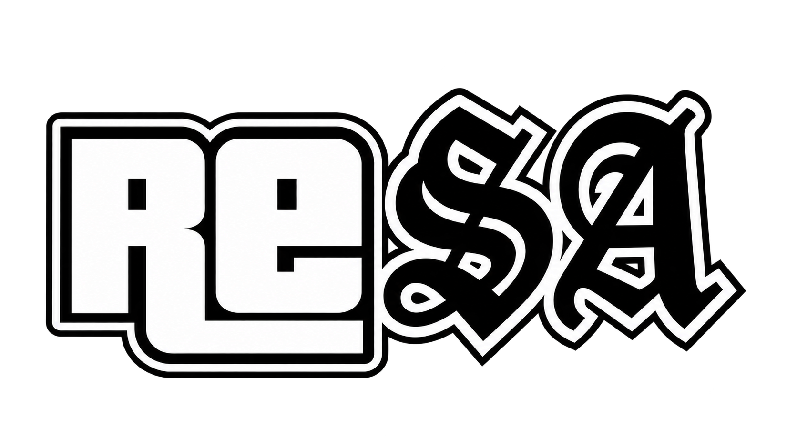

<p align="center">
  
</p>

# GTA San Andreas · Reversing en ReSA

Recrear GTA San Andreas PC de forma funcionalmente equivalente mediante código fuente reconstruido, reduciendo hasta eliminar la dependencia de funciones originales del ejecutable. La meta es una reconstrucción completa y validada, seguida de un ejecutable propio.

La [hoja de ruta de ReSA](docs/ProjectRoadmap.md) define el objetivo **ReSA — Zero Original Function Dependency**. Completar el catálogo es un hito intermedio.

**[🗺️ Mapa de clases y funciones](docs/MemoryMap/index.html) · [📊 Progreso](docs/ReversedClasses.md) · [🧭 Qué abordar después](docs/ReversingPriorities.md) · [🧪 Pruebas](reversing/README.md) · [📋 Proceso y continuidad](reversing/MEJORAS_DEL_PROCESO.md)**

> [!NOTE]
> Este README describe el trabajo local de la rama **ReSA**. El avance registrado y los bancos aprobados no equivalen a cobertura exhaustiva ni a estabilidad general del juego.

## Estado actual

<!-- RESA-CURRENT-STATUS:BEGIN -->
> **Estado al 16/10/2026 (Ciudad de México):** 784 grupos / 8552 funciones reconstruidas; 8552 con evidencia histórica y 0 pendientes de validación en 0 grupos. CAEVehicleAudioEntity completa: 102 funciones, 20024 pares, cero diferencias (corte 453). Vigencia acreditada: 0; la evidencia histórica no acredita dependencias ni independencia del EXE. Win::NOTSA_WinMain está excluida como adaptación NOTSA; conserva validated=0 en hooks_notsa.csv. El 100% describe sólo las entradas catalogadas, no todos los métodos de cada clase ni todo el EXE: 9223 entradas binarias sin nombre catalogado; 819 destinos originales explícitos fuera del catálogo, 395 referenciados desde entradas catalogadas. Estos conjuntos incluyen bibliotecas y funciones compartidas; no equivalen a funciones pendientes. [Cobertura fuera del catálogo](docs/BinaryCoverageAudit.md). Cohorte inicial de 499 dependencias: 105 aprobadas dentro del juego; 130 entradas del juego pendientes, 243 de bibliotecas y 21 inciertas. [Estado actual y alcance](docs/CurrentStatus.md). Los resultados y cifras del cuerpo conservan su fecha y alcance histórico.
<!-- RESA-CURRENT-STATUS:END -->

**Alcance del 100%:** las 8.445 entradas catalogadas tienen evidencia histórica; quedan funciones y métodos del juego fuera de ese catálogo. La [auditoría binaria y de dependencias](docs/BinaryCoverageAudit.md) identifica 924 destinos originales explícitos sin nombre catalogado, 499 con aristas desde funciones catalogadas, y 9.328 entradas binarias sin nombre del catálogo. Estos conjuntos se solapan e incluyen bibliotecas, helpers y código generado: no se suman ni equivalen a un total exacto de funciones faltantes. La vigencia acreditada sigue en 0.

**Lenguaje e independencia del EXE:** [tabla por clase y detalle de funciones](docs/ImplementacionesDelJuego.md), con C++, ensamblador, funciones mixtas, marcas `naked`, validación registrada y dependencias detectadas. Reconstruir en ensamblador también es ingeniería inversa; estar escrito en C++ no demuestra que el cuerpo deje de depender del EXE.

**Prioridad actual: C++ sin ensamblador escrito en producción.** Algunas clases ya reconstruidas y validadas todavía tienen ensamblador en su fuente y pasarán por un proceso de conversión de ensamblador a C++, con resultados idénticos al EXE y nueva validación dentro del juego. Archivos pendientes: [FILES.md](reversing/CppOnlyMigration/FILES.md). Se convierte `source/game_sa` conservando resultados exactos del EXE y repitiendo pruebas dentro del juego. La migración sigue pendiente; el 100% del catálogo no implica ausencia de ensamblador. [Inventario y conversiones comprobadas](reversing/CppOnlyMigration/README.md). **Regla del proyecto:** todo lo que se reconstruya va en C++, dos archivos por clase (`.cpp` y `.h`) y sin duplicados; el proceso está documentado en [PROCESO.md](reversing/CppOnlyMigration/PROCESO.md).

### Bloqueos de hooks

<!-- RESA-HOOK-UNLOCK-FINAL:BEGIN -->
**Bloqueos reales pendientes: 0.** Los seis locks restantes del corte anterior se retiraron después de pruebas dentro del juego y reparación del ABI. Los dos desbloqueos anteriores de CEntryExit/CPostEffects siguen acreditados en su banco. Los 413 indicadores históricos obsoletos no se presentan como desbloqueos nuevos.

| Clase | Hook | Bloqueado | Evidencia de conmutación |
| --- | --- | --- | --- |
| CAEVehicleAudioEntity | ProcessPlayerVehicleEngine | 0 | [Resumen](reversing/HookUnlockAudio/runs/20261010-170746-451158/summary.json) |
| CAEVehicleAudioEntity | ProcessVehicle | 0 | [Resumen](reversing/HookUnlockAudio/runs/20261010-170746-451158/summary.json) |
| CAEVehicleAudioEntity | Service | 0 | [Resumen](reversing/HookUnlockAudio/runs/20261010-170746-451158/summary.json) |
| Game | FrontendIdle | 0 | [Resumen](reversing/HookUnlockGame/runs/20261010-170235-722875/summary.json) |
| Game | Idle | 0 | [Resumen](reversing/HookUnlockGame/runs/20261010-170235-722875/summary.json) |
| Game | Render2dStuff | 0 | [Resumen](reversing/HookUnlockGame/runs/20261010-170235-722875/summary.json) |

Audio: 19.840 pares aislados, cero diferencias, 960 frames, 2.240 llamadas reales y 32 contextos. Se reprodujo un crash real por ECX: el caller EXE 0x4FC2A9 reutiliza ECX tras 0x4FC29B; el hook de IsAccInhibitedForLowSpeed conserva ahora ese registro mediante stackArguments=1. Game: 2.560 pares, 320 frames y 160 frames de render real; se conserva y prueba la guarda de background de Idle y se elimina el segundo parche no conmutable de Render2dStuff.
Se exige también la repetición completa de las 102 funciones (20.024 pares) y la misma campaña de audio con el perfil original del subsistema; ambos perfiles se ejecutan con los flags finales retirados. [Archivo y alcance de los cuatro bancos](reversing/HookUnlockFinal/README.md).

Se comprobaron restauración de hooks, configuración y partidas. La sesión de audio se descarta sin guardar; no se afirma restauración exacta de tareas, estadísticas o streaming ni estabilidad universal, todos los modelos o todos los controladores. Desbloqueo no significa independencia del EXE. El corte 453 conserva sus evidencias; el catálogo de progreso tiene 8445/8445 funciones con evidencia histórica y 771/771 grupos completos. Win::NOTSA_WinMain se registra aparte como adaptación NOTSA con validated=0 y hook conservado en 0x748710; su exclusión no acredita una validación nueva. [Clasificación NOTSA](docs/HooksNOTSA.md).
<!-- RESA-HOOK-UNLOCK-FINAL:END -->

### Migración a C++

Estado de la migracion a C++ al 16/10/2026: 821 funciones fuente convertidas y revalidadas (2 más, convertidas, esperan la corrida aprobada de su banco en la regresión final: [estudio del lote](reversing/CppTwelveLevel6Study/README.md)). Quedan 0 apariciones de ensamblador y 0 declaraciones naked en 0 archivos de source/game_sa; son conteos lexicos, no funciones. Excepcion documentada: source/app/platform/win/WindowedMode.cpp conserva __asm (extension NOTSA, fuera de source/game_sa). Lista completa: [archivos pendientes](reversing/CppOnlyMigration/FILES.md); evidencia y alcance: [migracion C++](reversing/CppOnlyMigration/README.md).

## Cómo funciona

La compilación produce `gta_reversed.asi`, una DLL que carga un ASI loader. Los hooks redirigen funciones del ejecutable a sus reconstrucciones en C++; las direcciones como `0x571920` identifican entradas del original. El proyecto todavía depende del ejecutable y de los recursos del juego: no es un ejecutable independiente terminado.

El objetivo es preservar el comportamiento original. Cada reconstrucción se contrasta con el original antes de actualizar sus indicadores; una compilación correcta o un hook visible en el debug no sustituyen esa comparación.

[FLOSS: instalación local y análisis de cadenas](docs/FLOSS.md). Disponible para Codex y Claude en `C:\Users\pedro\Tools\FLOSS\floss.exe`; todavía no hay resultados de FLOSS registrados para ReSA.

## Instalación

### Abrir el juego desde el inicio

**Instalación de pruebas documentada el 8 de octubre de 2026:** ASI normal con selector histórico explícito; 694 grupos / 6136 funciones habilitadas, 2313 hooks desactivados y cero discrepancias de estado en el informe de arranque. SHA-256 `f33a7f5ca0ebdb08f4f77d91c2f8142c4a2776761191c3e683eb352fc3438cae`. [Configuración, respaldo y evidencia](reversing/RequestedValidation20261008/historical-launch/README.md). Esto no sustituye una prueba de comportamiento de todas las funciones juntas.

La copia de pruebas tiene `FastLoader.Enable = false` y `SaveGameToLoad = -2`. Muestra las pantallas de inicio y el menú; el usuario elige **Nueva partida** o **Cargar partida**.

```powershell
Set-Location 'D:\JUEGOS\GTA San Andreas - CVehicle Test'
& '.\gta_sa.exe' '--historical-hooks=D:\JUEGOS\GTA San Andreas - CVehicle Test\historical-hooks.txt'
```

Este arranque aplica el perfil histórico: sólo clases/grupos con todas sus entradas catalogadas marcadas validated=1. Sin el argumento de selección se conserva el comportamiento normal de la compilación. Los bancos automáticos activan temporalmente la carga rápida solicitando la ranura 2 y restauran los dos INI originales al terminar, incluso si la prueba falla.

En las últimas pruebas, la versión del guardado de esa ranura no coincidió y el juego inició partida nueva; no se forzó la carga ni se modificó el guardado.

[Configuración y comprobación del inicio](reversing/InicioNormal/README.md) · [Diagnóstico y reparación del cierre de audio](reversing/CAESound/README.md).

### Ejecutar las pruebas

Desde la raíz, usar el **único `PROBAR.cmd`**:

```powershell
.\PROBAR.cmd --list
.\PROBAR.cmd --case furniture
.\PROBAR.cmd --case playerinfo-constructor
.\PROBAR.cmd --all
```

Para ejecución sin la pausa final del CMD:

```powershell
python reversing/run.py --case furniture
python reversing/run.py --all
```

El catálogo está en [reversing/cases.json](reversing/cases.json). Las sondas deben estar compiladas y archivadas con el hash esperado por cada ejecutor; ejecutar un caso no recompila automáticamente la sonda. `--all` requiere disponer de los artefactos locales de todos los bancos.

El runner compartido comprueba el ejecutable, evita ejecuciones simultáneas, respalda ASI/PDB, instala la sonda, abre su propio GTA, audita los logs, cierra ese proceso y restaura los binarios y ambos INI. Verifica los hashes de las partidas. Los informes por caso quedan en la copia de pruebas; los informes conjuntos, en `reversing/artifacts/suite-*/summary.json`.

> [!IMPORTANT]
> `--all` ejecuta **sondas archivadas** de cada trabajo. No demuestra que todos los cambios sean estables juntos en la última compilación. La campaña de integración, guardado/carga y sesiones prolongadas se hará cuando estén completas todas las clases, según lo acordado en el [proceso](reversing/MEJORAS_DEL_PROCESO.md).

#### Instalación y datos protegidos

| Uso | Ruta del entorno local |
| --- | --- |
| Repositorio | `D:\Original\gta-reversed-master` |
| Copia de pruebas | `D:\JUEGOS\GTA San Andreas - CVehicle Test` |
| Instalación personal, conservar | `E:\JUEGOS\GTA San Andreas` |

La instalación normal se actualiza únicamente en la copia de pruebas y conserva un respaldo. Los cambios no deben sobrescribir partidas personales. El runner actual tiene rutas locales configuradas; revisar [runtime_runner.py](reversing/runtime_runner.py) y el proceso antes de usarlo en otra máquina. `PROBAR.cmd` también apunta al Python instalado en este equipo.

El ejecutable de referencia es **GTA SA Compact**, distinto de otros ejecutables llamados «1.0 US». SHA-256 verificado en este entorno:

```text
72ae59e44c761389e354a50dc6215e964fe771121e2f4b1877273a493ceecc9b
```

Los bancos habituales arrancan con `--unhook=Audio,Global/SurfaceInfos_c`. El caso `sound-copy` mantiene Audio activo y solo excluye SurfaceInfos. Esa exclusión limita sus conclusiones; una futura validación de funciones de audio necesita configurar y comprobar explícitamente sus hooks. Las pruebas son automáticas y no requieren una demostración visual.

## Avance y evidencia

### Estado del trabajo

**Lote del 07/10/2026:** [78 funciones pendientes reconstruidas y validadas](reversing/PendingBatch/README.md), en 27 clases; 30 bancos y 81.664 pares exactos contra el EXE. Los límites de fixtures y dependencias se detallan por banco.

**Entrega anterior (05/10/2026):** tanda de clases de 34 a 58 funciones validadas dentro del juego contra `gta_sa.exe` 1.0 US: [CBaseModelInfo](reversing/Model34/README.md), [CCutsceneMgr](reversing/Cutscene35/README.md), [CCustomCarEnvMapPipeline](reversing/EnvMap37/README.md), [RpAnimBlend](reversing/RpAnim43/README.md), [CFileLoader](reversing/FileLoader47/README.md), [CReplay](reversing/Replay47/README.md), [SurfaceInfos_c](reversing/Surface47/README.md), [CObject](reversing/Object48/README.md), [CPlayerPed](reversing/PlayerPed51/README.md), [CPedIntelligence](reversing/PedIntel52/README.md), [CAEAudioHardware](reversing/AudioHw54/README.md), [CPhysical](reversing/Physical56/README.md), [CAEPedSpeechAudioEntity](reversing/PedSpeech58/README.md) y [CControllerConfigManager](reversing/CtrlConfig58/README.md). Se corrigieron diferencias reales con el EXE (direcciones de hooks `_N` de RpAnimBlend, radio de `CReplay::TriggerPlayback`, `CPlayerInfo::operator=`, guardas de nulo en destructores de rutas de punto). Regresión completa de 169 bancos terminada el 05/10 sin fallos pendientes; **5.322 funciones validadas, 221 casos**. El menú F7 (ImGui) está retirado del juego y los bugfixes reversibles desactivados por defecto, como el EXE.

**Entrega anterior (01/10/2026, lote de audio):** [lote de audio](reversing/AudioCompletion/README.md): `UpdateAmbienceTrackAndVolume`, `AddAudioEvent` y `SetAudioBuffer` reconstruidas, habilitadas y validadas con **10.086 pares exactos** dentro del motor. Antes hubo que corregir un defecto real en cada una: el original lee la frecuencia objetivo y no el volumen, una constante difería en un ulp y el buffer de DirectSound llevaba un flag equivocado. Además, el catálogo cuadra ahora con lo que el juego registra de verdad: se activó `DoneSettingUpConversation` (ya validada), `InitialiseDirtTexture` vuelve a pendiente, los 4 hooks aplazados de CustomBuilding dejan de ejecutarse y se catalogan los 3 hooks del modo ventana. `audit_hook_catalog.py --runtime` da 0 diferencias. ASI probado 60 s en partida.

**Entrega anterior (01/10/2026):** [hooks de 39 clases activados](reversing/HooksActivados/README.md). Nueve tareas con `InjectHooks()` ya escrito pero comentado en `InjectHooksMain` quedaron registradas; otras 30 clases (28 tareas y 2 entidades de audio) recibieron un `InjectHooks()` nuevo, con cada vtable verificado contra `gta_sa.exe`. 216 entradas nuevas en `hooks.csv`; los stubs `plugin::Call` y tres `Clone` no fieles quedan con `reversed=0`. Compilación Debug y arranque al menú sin errores; sin comparaciones función a función todavía. La auditoría detecta ahora llamadas que resuelven a un `InjectHooks` heredado. Además se añadieron plantillas sin reconstruir para 21 clases que no existían en el código; no cambian el catálogo. **Segunda tanda:** 15 clases con `InjectHooks()` escrito pero nunca invocado desde la importación del upstream (`CHud`, `CPedAttractor`, `CIdleCam`, …) y 6 tareas con vtable localizado en el EXE; 144 entradas nuevas. Antes de activarlas se corrigieron un stub instalado como reconstruido (`CDecision::Set`), un vtable equivocado (`CLodTimeModelInfo`) y un destructor duplicado (`CTaskSimpleNone`). Probado 35 s dentro de partida sin asserts. La [comparación EXE ↔ código](reversing/HooksActivados/README.md#exe-contra-código-qué-hay-en-uno-y-no-en-el-otro) encontró siete hooks heredados del upstream con direcciones a mitad de función, ya [corregidos](reversing/HooksActivados/README.md#direcciones-corregidas-2026-10-01) (seis con su dirección real y `EnableConversation` retirado por no existir en el EXE; probado 60 s en partida), y siete diferencias de `reversed` entre catálogo y código, pendientes.

**Entrega anterior (30/09/2026):** [CConversationForPed, 2/2](reversing/ConversationForPed/README.md): `Update` y `IsPlayerInPositionForConversation` reconstruidas y contrastadas con 4.702 pares exactos dentro del motor (2.288 y 2.414, respectivamente). Cierre natural con código 0 y restauración comprobada. Binario normal instalado en la copia de pruebas tras tres arranques de tres segundos en estado de juego, con los dos hooks conectados y tres cierres con código 0. Partidas y configuración conservadas.

**Entrega previa (27/09/2026):** [CPedToPlayerConversations, 3/3](reversing/PedToPlayerConversations/README.md): Update reconstruido y habilitado tras 6.266 pares exactos; binario normal instalado en la copia de pruebas. Tres arranques breves de tres segundos y cierres con código 0. Las pruebas de diez segundos detectaron un bloqueo intermitente de precarga de audio de PROLOG1, reproducido también con el ASI anterior; queda documentado y sin corregir. Partidas e INI conservados. Incluye la [corrección de cierre anterior](reversing/ShutdownLists/README.md); CustomBuilding quedó aplazado en aquella entrega; sus cuatro pendientes se cerraron en el lote del 07/10/2026.

La fuente del progreso es [docs/hooks.csv](docs/hooks.csv). El [informe generado](docs/ReversedClasses.md) muestra totales, pendientes y bloqueos; la [guía técnica de prioridades](docs/ReversingPriorities.md) ordena el trabajo por esfuerzo estimado, dependencias y facilidad de validación.

**Corte documental vigente (5 de octubre de 2026, hora de México):** 666 clases completas, 103 parciales y 2 sin revertir; 7.858 de 8.441 entradas registradas como reconstruidas. La auditoría bidireccional del catálogo pasa en modo estricto: no hay hooks activos fuera de `hooks.csv`, registros indirectos sin catalogar, clases del CSV sin scope fuente, owners activos sin catálogo ni llamadas `X::InjectHooks()` que resuelvan al `InjectHooks` heredado de una base. Estos números miden el catálogo registrado, no líneas de código ni porcentaje de comportamiento probado.

#### Dimensiones de progreso

| Dimensión | Estado |
| --- | --- |
| Clases completas | 784/784 · 100,00% |
| Clases validadas (de las completas) | 784/784 · 100,00% |
| Funciones reconstruidas | 8.552/8.552 · 100,00% |
| Funciones validadas (de las reconstruidas) | **8.552/8.552 · 100,00%** · evidencia aprobada vinculada |

La validación se mide sobre lo ya completado o reconstruido: solo se valida lo que existe en la DLL. Las 4 extensiones o adaptaciones NOTSA ([hooks_notsa.csv](docs/hooks_notsa.csv)) quedan fuera de la cuenta.

##### Siguientes mediciones

Todavía no tienen un porcentaje útil; la tabla explica qué falta hacer para poder medirlas.

| Dimensión | Estado actual | Qué hay que hacer |
| --- | --- | --- |
| Validaciones vigentes para el árbol actual | 0/8.552 validadas confirmadas como vigentes | Volver a correr los bancos de cada función validada sobre el árbol actual, comprobar que sus dependencias no cambiaron desde la evidencia y registrar el resultado en el [registro de validaciones](reversing/ValidationRegistry/README.md). |
| Dependencias de funciones originales eliminadas | No medido | Auditar, por cada función reconstruida, las llamadas directas y transitivas que aún saltan al EXE (`plugin::Call*`, direcciones fijas, hooks sin reconstruir) y contar las que ya no dependen de ninguna. |

Quedan 0 entradas pendientes, 0 clases incompletas y 0 locks. En `hooks.csv`, `type=S` significa **Simple hook** (función normal por dirección) y `type=V` significa **Virtual hook** (entrada de vtable). `validated=1` significa que existe evidencia aprobada vinculada; no significa por sí solo que esa evidencia siga vigente para el árbol actual. Las 8.440 entradas sin lock no equivalen a funciones independientes. El catálogo tampoco es un inventario exhaustivo del EXE. La [hoja de ruta](docs/ProjectRoadmap.md) establece criterios para la suite reproducible, regresión de juego, subsistemas independientes y ejecutable propio. El [registro de validaciones](reversing/ValidationRegistry/README.md) alimenta el panel; las entradas aún no acreditadas requieren consolidación o revisión, no se clasifican como fallidas. Consultar el panel generado para recuentos posteriores.

La [auditoría de bloqueos](reversing/HookUnlockAudit/README.md) distingue dos desbloqueos reales probados dentro del juego de 413 indicadores históricos que ya no correspondían a un bloqueo en la fuente ni en la DLL. Permanecen bloqueados tres hooks de audio y tres del bucle/render del juego.

#### Auditoría del catálogo de hooks

La coherencia entre código y catálogo se comprueba con:

```powershell
python contrib/audit_hook_catalog.py --strict
```

Para ver además owners inactivos, registros indirectos y aliases informativos:

```powershell
python contrib/audit_hook_catalog.py --strict --verbose
```

El modo estricto falla únicamente ante inconsistencias del registro activo. Los hooks presentes en fuente pero deliberadamente no registrados se muestran sólo como información y no se añaden automáticamente a los porcentajes.

#### Reconstrucciones recientes con evidencia local

Las comparaciones corresponden al alcance descrito en cada README, no necesariamente a todas las funciones de la clase.

| Clase / módulo | Estado registrado | Pares original/candidato | Evidencia |
| --- | ---: | ---: | --- |
| `RpAnimBlend` | 43/43 | 652 | [Alcance y resultados](reversing/RpAnimBlend/README.md) |
| `CBaseModelInfo` | 34/34 | 65.536 | [Alcance y resultados](reversing/CBaseModelInfo/README.md) |
| `FxManager_c` | 25/25 | 720 | [Alcance y resultados](reversing/FxManager/README.md) |
| `CClouds` | 21/21 | 1.170 | [Alcance y resultados](reversing/CClouds/README.md) |
| `CMenuSystem` | 21/21 | 784 | [Alcance y resultados](reversing/CMenuSystem/README.md) |
| `CTaskSimpleUseGun` | 19/19 | 3.232 | [Alcance y resultados](reversing/CTaskSimpleUseGun/README.md) |
| `CTaskComplexWander` | 14/14 | 10.240 | [Alcance y resultados](reversing/CTaskComplexWander/README.md) |
| `CTaskSimpleJetPack` | 14/14 | 128 | [Alcance y resultados](reversing/CTaskSimpleJetPack/README.md) |
| `CPed` | 145/145 | 28.672 | [Alcance y resultados](reversing/CPed/README.md) |
| `CPedToPlayerConversations` | 3/3 | 6.266 | [Alcance y resultados](reversing/PedToPlayerConversations/README.md) |
| `CConversationForPed` | 2/2 | 4.702 | [Alcance y resultados](reversing/ConversationForPed/README.md) |
| `CConversations` | 10/10 | 2.048 | [Alcance y resultados](reversing/CConversations/README.md) |
| `CPedList` | 7/7 | 4.096 | [Alcance y resultados](reversing/CPedList/README.md) |
| `CPlayerInfo` | 28/28 | 16.896 + 4.224 del constructor | [Alcance y resultados](reversing/CPlayerInfo/README.md) |
| `FurnitureSubGroup_c` | 3/3 | 20.480 | [Alcance y resultados](reversing/FurnitureSubGroup_c/README.md) |
| `CGeneral` | 9/9, sin bloqueos | 65.536 | [Alcance y resultados](reversing/CGeneral/README.md) |
| `CClothes` | 11/11 | 4,096 | [Alcance y resultados](reversing/CClothes/README.md) |
| `CScripted2dEffects` | 5/5 | 256 | [Alcance y resultados](reversing/CScripted2dEffects/README.md) |
| `CTaskComplexUseClosestFreeScriptedAttractorSprint` | 4/4 | 4,096 | [Alcance y resultados](reversing/CTaskComplexUseClosestFreeScriptedAttractorSprint/README.md) |

**Desbloqueos anteriores:** [DataStream y TrackEntity](reversing/UnlockBatch2/README.md), diez candados retirados tras 15.360 pares y 64 combinaciones de DataStream. CSV y catálogos sincronizados. Tras ampliar el catálogo con los owners activos que faltaban, quedan **622 candados** en el registro vigente. Los 85 restantes del lote solicitado se aplazan; sus borradores se conservan fuera de la compilación. ASI normal instalado en la copia de pruebas: inicio al menú y 30 segundos de integración sin exclusiones comprobados; los avisos históricos y los límites constan en el informe.

**Corrección anterior:** [aviso de pivote IK y datos incompletos](reversing/IKDataWarnings/README.md): 131 pares de cadenas contra el original, tablas de clima y grupos de coches coincidentes con los datos reparados. Integración de aquella entrega: 121,16 s y 3.605 fotogramas sin los avisos comprobados. Se conserva la reparación de [peatones](reversing/FallenPeds/README.md), la reserva de [CEntryExit](reversing/CEntryExitPool/README.md) de 512 plazas, las partidas, el inicio normal y los 85 bloqueos aplazados.

**Comprobación anterior:** [recuperación natural del ratón](reversing/MouseRecovery/README.md). Tras fallar con la ventana oculta y sin foco, Acquire y la lectura tienen éxito a los 1,485 segundos; 120 actualizaciones válidas. Aquella observación no cambió el ASI normal. Sus resultados se conservan como evidencia histórica.

**Tanda anterior:** [24 bloqueos retirados y plataforma conmutable](reversing/Unlocks/README.md). 50.432 pares de función, más 324 pares repetidos en nueve arranques y 18 comprobaciones de entrada SDL/ImGui. CGeneral ya estaba desbloqueado. Se repararon contratos ABI, memoria, entrada y dimensiones de cámara; el CSV mantiene los mismos totales de progreso.

**Cierre anterior:** [diez clases del Top 10](reversing/Top10/README.md), 22 entradas nuevas y 51.712 comparaciones exactas. Incluye Shooting, recursos de scripts, LeaveCarAndWander, WaitForBus, PopCycle, CarCtrl, KillThreatsBasic, FxPrimBP, EntityScanner y DragPedFromCar.

El constructor de `CPlayerInfo` ya fue corregido, validado y desbloqueado; incluye regresiones de entrega y selección de armas. `CQuadBike::ProcessControl` tiene un candidato que compila, pero continúa **sin validar y deshabilitado**, con progreso 11/12. Se conservan también los bancos históricos de vehículos, guardados, jugador y efectos de armas.

### Listas solicitadas anteriormente

<!-- USER LISTS STOP STATUS -->
Estado de las listas solicitadas al detener el trabajo: [reconstrucción y validación parcial](docs/EstadoListasSolicitadas.md). Las 67 clases tienen la reconstrucción solicitada aplicada; el último lote quedó con 117/354 funciones verificadas con las fuentes finales y un fallo pendiente en el destructor de GangFollower.
<!-- /USER LISTS STOP STATUS -->

Solicitud posterior: [`Interior_c` quedó reconstruida y validada](docs/InteriorValidation.md), con 52/52 funciones catalogadas y 74.752 comparaciones finales. El lote anterior permanece detenido; sus cifras de replay corresponden al cierre histórico indicado.

## Pendientes

### Flujo para continuar

1. Leer [MEJORAS_DEL_PROCESO.md](reversing/MEJORAS_DEL_PROCESO.md), incluida la última continuidad, y comprobar rama y cambios de Git.
2. Revisar funciones pendientes, contrato original, llamadas y código comparable. La guía de prioridades es una estimación, no una orden para habilitar código.
3. Reconstruir y comparar original/candidato dentro del motor con entradas reproducibles, contadores y restauración de estado.
4. Solo después de validar, actualizar `reversed/locked` en `hooks.csv`, documentar resultados y regenerar el informe:

   ```powershell
   python contrib/hooks2md.py --input docs/hooks.csv --output docs/ReversedClasses.md
   ```

5. Restaurar las fuentes instrumentadas, compilar normalmente e instalar solo en la copia de pruebas con respaldo. Conservar límites, hashes y evidencia en `reversing/<clase>/`.

Los artefactos voluminosos, logs y cachés locales no se incluyen en Git. No hacer commit ni push sin solicitud expresa. Mantener los cambios previos y reutilizar la infraestructura existente.

## Compilar

La configuración del repositorio usa **Windows, MSVC, x86, C++23 y Debug** por defecto. Véanse [perfil Conan](conan/profiles/windows-msvc.txt), [CMakeLists.txt](CMakeLists.txt) y [conanfile.py](conanfile.py): CMake requiere 4.2.0 o superior y el perfil actual selecciona MSVC 195. El entorno utilizado tiene Visual Studio 2026, Python y Conan 2.

Preparación de un entorno nuevo con las herramientas instaladas:

```powershell
python -m pip install conan
conan profile detect
python setup.py
python setup.py --build
```

Para recompilar el directorio `build` ya configurado:

```powershell
cmake --build build --config Debug
```

Salida del entorno local: `bin/Debug/gta_reversed.asi` y `.pdb`. El proceso documenta la ruta del CMake disponible en la caché local cuando no está en `PATH`. No mover esa caché sin revisar las rutas de compilación.

Se necesita una copia propia del juego y sus recursos, además de un ASI loader compatible. Las instrucciones generales heredadas de instalación están en [contrib/install.py](contrib/install.py); revisar sus rutas y enlaces antes de aplicarlas. El flujo local de validación usa respaldos y la copia de pruebas descrita arriba.

## Contribuir

### Proyecto original y contribuciones

Este trabajo continúa [gta-reversed](https://github.com/gta-reversed/gta-reversed). Se conservan los [criterios de código](docs/CodingGuidelines.MD) y el reconocimiento a sus autores. Comunidad original: [GTA Groupies](https://discord.gg/FG8XJ5Npqe). No hay una fecha comprometida para completar todo el proyecto.

## Historia

### Comparación técnica con `gta-reversed/gta-reversed`: por qué su progreso no cuenta toda la historia

Este proyecto parte del trabajo público de [gta-reversed/gta-reversed](https://github.com/gta-reversed/gta-reversed), que sigue siendo una referencia importante para nombres, estructuras, direcciones y reconstrucciones de GTA San Andreas. La comparación siguiente no pretende borrar ese trabajo: explica por qué **su forma actual de medir y presentar el progreso es insuficiente** y por qué ReSA mantiene un catálogo, una auditoría y un registro de validación más estrictos.

Esta comparación conserva su corte histórico. Los contadores vigentes de ReSA están en [Dimensiones de progreso](#dimensiones-de-progreso).

#### El primer problema: su propio README reconoce que el progreso está desactualizado

El README de `gta-reversed/gta-reversed` dice literalmente que el seguimiento de clases **“needs to be updated”** y, al mismo tiempo, presenta una estimación general de **“about 50-60% of the code is done”**.

Ese número no está ligado a un procedimiento reproducible visible en el repositorio. En cambio, su `docs/hooks.csv` registraba en aquel corte:

| Métrica | gta-reversed upstream | ReSA |
| --- | ---: | ---: |
| Clases/grupos catalogados | 701 | **772** |
| Entradas catalogadas | 8.014 | **8.442** |
| Marcadas como reconstruidas | 7.428 | **7.857** |
| Pendientes | 586 | **585** |
| Clases completas | 584 | **665** |
| Clases parciales | 114 | **104** |
| Sin revertir | 3 | **3** |
| Locks registrados | 713 | **677** |
| Evidencia aprobada por función (`validated=1`) | sin columna equivalente | **40** |

Por tanto, hay dos métricas distintas en upstream que no deben mezclarse: una estimación informal del “50-60% del código” y un catálogo de hooks que marca aproximadamente **92,69%** de sus entradas como `reversed=1`. Ninguna de las dos, por sí sola, significa “porcentaje del juego terminado”, pero el README no ofrece una metodología que conecte ambas cifras.

ReSA tampoco interpreta su **93,07%** como “93,07% del juego terminado”. Aquí ese porcentaje significa solamente: **7.857 de 8.442 entradas catalogadas en aquel corte tenían `reversed=1`**.

#### El segundo problema: el catálogo upstream no es bidireccional

La diferencia se hizo visible al revisar el subsistema `Conversations`.

En el código público upstream existen:

- `CConversationForPed::InjectHooks()`
- `CConversationNode::InjectHooks()`
- `CPedToPlayerConversations::InjectHooks()`

pero esos tres owners **no aparecen en su `docs/hooks.csv`** y tampoco se llaman directamente desde su `InjectHooksMain.cpp`.

Eso provoca que funciones reales presentes en la fuente queden fuera del denominador del progreso.

Ejemplo especialmente claro:

```cpp
bool CConversationForPed::IsPlayerInPositionForConversation(bool randomConversation) {
    return plugin::CallMethodAndReturn<bool, 0x43AC40, CConversationForPed*, bool>(
        this,
        randomConversation
    );
}
```

La función continúa ejecutando lógica del EXE original, pero en upstream su instalación es:

```cpp
RH_ScopedInstall(IsPlayerInPositionForConversation, 0x43AC40);
```

sin `.reversed = false`.

Aun así, el problema ni siquiera llega a alterar sus estadísticas porque **`CConversationForPed` no está incluido en el CSV**. Es decir: una dependencia original puede existir en fuente y quedar fuera de la medición completa.

ReSA corrigió este caso de dos formas:

1. registra los owners faltantes en el flujo global;
2. marca explícitamente como pendientes las funciones que todavía llaman al EXE.

El 30 de septiembre se completaron además las dos reconstrucciones de `CConversationForPed`, con [4.702 pares dentro del motor](reversing/ConversationForPed/README.md). El ejemplo anterior describe el código upstream observado; ReSA ya sustituye esas dos funciones.

El estado real del subsistema queda así:

| Owner | upstream en hooks.csv | ReSA |
| --- | ---: | ---: |
| `CConversations` | 10/11 | **10/10** ¹ |
| `CConversationNode` | no catalogada | **1/1** |
| `CPedToPlayerConversations` | no catalogada | **3/3** |
| `CConversationForPed` | no catalogada | **2/2** |

¹ El 01/10/2026 se retiró `EnableConversation`: no existe como función propia en el EXE y su dirección (0x43A7F0) caía dentro de `CConversations::Clear`. Ver [HooksActivados](reversing/HooksActivados/README.md#direcciones-corregidas-2026-10-01).

Y `CConversations::DoneSettingUpConversation`, que en upstream todavía es:

```cpp
plugin::Call<0x43ADB0, bool>(bSuppressSubtitles);
```

en ReSA ya tiene una reconstrucción C++ documentada y un banco de comparación de **2.048 pares original/candidato** para su alcance.

#### El tercer problema: “reversed” no significa “validado”

El upstream genera `ReversedClasses.md` desde `hooks.csv`, pero ese documento incluso incluye su propio disclaimer:

> los porcentajes y el número de clases pueden no ser completamente exactos porque no todas las clases y funciones están documentadas.

Ese disclaimer es correcto, pero deja una consecuencia importante: **una clase completa en el panel no demuestra equivalencia funcional**.

ReSA separa explícitamente cuatro dimensiones:

1. **Reconstruida:** existe una implementación C++ registrada.
2. **Validada:** existe evidencia original/candidato vinculada a una versión concreta.
3. **Desbloqueada:** el hook ya no conserva un lock preventivo.
4. **Independiente del EXE:** ni la función ni sus dependencias necesitan ejecutar lógica original.

Una función puede estar reconstruida y no validada. Puede estar validada y todavía depender transitivamente del EXE. Puede estar desbloqueada sin que eso pruebe independencia.

Por eso ReSA mantiene por separado:

- [`docs/hooks.csv`](docs/hooks.csv)
- [`docs/ReversedClasses.md`](docs/ReversedClasses.md)
- [`docs/ValidationInventory.md`](docs/ValidationInventory.md)
- [el registro de validaciones](reversing/ValidationRegistry/README.md)
- los bancos y resúmenes de evidencia bajo [`reversing/`](reversing/)
- [la hoja de ruta hacia independencia](docs/ProjectRoadmap.md)

En la búsqueda pública realizada sobre upstream no aparece un equivalente a `ValidationInventory.md`, `audit_hook_catalog.py` ni un registro de `validation-summary` que conecte sistemáticamente cada función con evidencia versionada.

Eso no demuestra que sus colaboradores nunca prueben nada. Significa algo más concreto: **el repositorio no expone una contabilidad equivalente que permita auditar esas pruebas función por función desde el propio árbol**.

#### El cuarto problema: un generador no arregla un inventario incompleto

Upstream dice que `ReversedClasses.md` se actualiza automáticamente cuando cambia `hooks.csv`. Eso está bien, pero automatizar la generación no garantiza que la entrada sea completa.

Si el flujo es:

```text
hooks.csv incompleto
    ↓
generador automático
    ↓
ReversedClasses.md perfectamente generado
```

el resultado sigue siendo un informe perfectamente generado **sobre un denominador incompleto**.

ReSA añadió una comprobación en la dirección contraria:

```powershell
python contrib/audit_hook_catalog.py --strict
```

La auditoría revisa fuente → registro → CSV y actualmente exige que sean cero:

- hooks activos ausentes de `hooks.csv`;
- registros indirectos activos ausentes del CSV;
- entradas del CSV sin scope correspondiente en fuente;
- llamadas activas con instalaciones propias sin owner catalogado.

Los hooks escritos pero deliberadamente inactivos se reportan con `--verbose`, pero no se añaden artificialmente al progreso.

#### Entonces, ¿qué le falta realmente a upstream?

No basta con “revertir más funciones”. Para que su porcentaje pueda interpretarse con rigor, todavía necesita al menos:

- auditar bidireccionalmente `InjectHooksMain`, scopes e instalaciones contra `hooks.csv`;
- incorporar owners que existen en fuente pero no están catalogados cuando forman parte del registro activo;
- marcar consistentemente `.reversed = false` en wrappers que todavía ejecutan el original;
- separar reconstrucción de validación;
- vincular evidencia reproducible a funciones concretas y versiones concretas;
- medir dependencias directas y transitivas del ejecutable original;
- distinguir hooks activos de código de reversing que existe pero está deshabilitado;
- evitar presentar una estimación general de progreso como si fuera equivalente al porcentaje del catálogo;
- mantener el panel de progreso como una consecuencia del inventario auditado, no como sustituto de ese inventario.

#### Lo que sí sabemos y lo que todavía no sabemos

**Sabemos** que ReSA tiene actualmente 8.442 entradas auditadas, frente a 8.014 en el catálogo upstream. Sabemos exactamente cuáles están marcadas como reconstruidas, cuáles pendientes y cuáles bloqueadas. Sabemos también que el catálogo upstream omite al menos owners del subsistema Conversations que sí existen en su fuente.

**Sabemos** que ReSA ha encontrado candidatos aparentemente correctos que no coincidían con el original hasta compararlos dentro del motor. Por eso aquí “el código compila” o “la clase aparece completa” no se considera evidencia suficiente.

**No sabemos todavía** qué porcentaje del comportamiento total de GTA San Andreas representa el catálogo completo. Tampoco tenemos aún una medida global de cuántas funciones reconstruidas siguen dependiendo transitivamente del EXE. ReSA lo declara como desconocido en vez de convertirlo en un porcentaje decorativo.

La diferencia metodológica puede resumirse así:

```text
gta-reversed:
    función escrita
        → hook
        → reversed=1
        → porcentaje

ReSA:
    función reconstruida
        → registro auditado
        → comparación con el original
        → evidencia versionada
        → estado de lock
        → revisión de dependencias
        → progreso por dimensiones
```

El objetivo no es ganar una carrera de porcentajes. El objetivo es poder llegar a **ReSA — Zero Original Function Dependency** y demostrar, paso a paso, qué parte del juego ya no necesita la lógica original.

## Licencia y créditos

### Créditos

- Todos los colaboradores del proyecto [plugin-sdk](https://github.com/DK22Pac/plugin-sdk).
- Todos los colaboradores del [proyecto original](https://github.com/codenulls/gta-reversed).
- Cientos de personas que han compartido sus conocimientos en [gtaforums.com](https://gtaforums.com/topic/194199-documenting-gta-sa-memory-addresses).
- El [equipo de re3](https://github.com/GTAmodding/re3).
- Todas las personas que han contribuido a la ingeniería inversa de GTA San Andreas.
